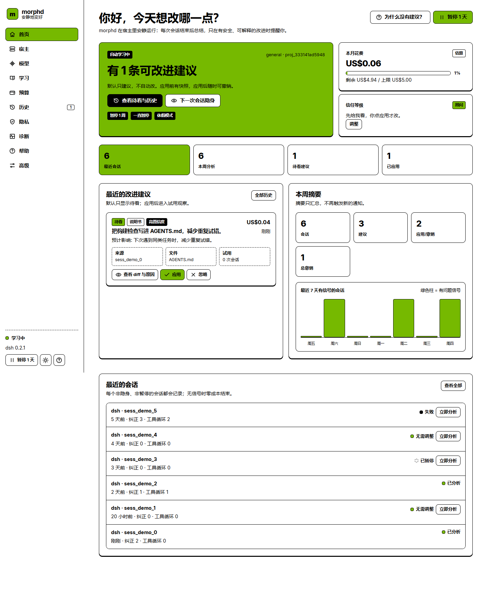

# morphd

> 让 Agent 自己变好，但不打扰你。

morphd 是一个**本地优先、宿主内运行**的 Agent harness 自动优化产品：照常使用
**dsh / Claude Code / Codex**，每次会话结束后安静总结；当出现失败、反复纠正或工具循环时，
用你自带的模型（BYOK）生成一条可理解、可预算、可撤销的改进建议。默认只建议，不自动改；
所有应用都有快照，所有自动应用都有试用与回滚。



- **PRD**：[`PRD-v0.5.md`](PRD-v0.5.md)（唯一产品定义，附录 C 为实现契约）
- **License**：Apache-2.0。上游 Harness² 保持原样，不修改、不 fork。
- **形态**：宿主插件/伴生进程 + 本地 Web UI；NPM 与 Electron 双包共用同一引擎与 UI。
- **不常驻**：没有 daemon、cron、systemd、launchd、开机自启或独立后台队列。

> **交付状态**：仓库包含可运行的引擎、消费层后端、三色 Web UI、NPM CLI、Electron 壳与
> 测试。真实 dsh/Claude/Codex 生命周期、平台二进制签名、Windows `.exe` 安装包与 npm
> 正式发布仍需真机/发布环境证据；未验证项在 [`docs/verification.md`](docs/verification.md)
> 中明确标注 `n/a`/beta，而不是静默通过。

---

## 产品默认值

| 项 | 默认 |
|---|---|
| 信任等级 | 顾问（只建议，不自动改） |
| 变更幅度 | 保守（只改现有说明书；1 文件 / 30 行；不新增脚本） |
| 自动应用 | 关 |
| 通知 | 应用内；系统通知关；静默时段 22:00–08:00 |
| 每周主动建议 | 最多 2 条；其余进入待看 |
| 数据保留 | 30 天；遥测关 |
| 视觉 | 仅 `#76B900` + `#FFFFFF` + `#000000`；无灰/渐变/半透明；圆角 4/6/8/10px |

---

## 快速开始

### 从源码运行（开发/自托管）

```sh
python3.12 -m venv .venv
. .venv/bin/activate
pip install -e ".[dev]"           # 或 uv pip install
npm --prefix consumer/web install
npm --prefix consumer/web run build

# 发现并适配宿主（会打印本地 UI 地址；也可以先 --dry-run）
morphd setup --host dsh --project /path/to/project
# 只启动配置 UI（不启动自动学习；随进程退出）
morphd serve --config-only --open
```

消费级路径（`setup`/`serve`/`host`/BYOK 分析）不需要安装 Harness²；只有高级严格评测
CLI（`run`/`evaluate`/`promote`）需要 pinned 上游或 `MORPHD_HARNESS2_SRC`。

本地 UI 地址形如 `http://127.0.0.1:<随机端口>/#bootstrap=<一次性令牌>`。令牌在 URL
fragment 中，不进入日志或查询参数；页面交换为 HttpOnly、SameSite=Strict 会话 cookie，
所有写请求再校验 CSRF。不得从局域网访问。

### NPM（发布后）

```sh
npx @morphd/cli@latest setup
npx @morphd/cli@latest doctor
npx @morphd/cli@latest uninstall
```

`setup` 完成宿主检测/适配，并打开三步引导 UI（宿主、模型/BYOK、预算与隐私）。
完成引导后按 Ctrl+C 关闭临时安装器 UI；安装器不会常驻。

包名与 scope 需在发布前完成 npm registry 注册与组织确认。平台引擎通过
`optionalDependencies` 分发，不使用任意 `postinstall`，不从任意 URL 下载可执行文件。

### Electron 桌面壳（Windows C0）

```sh
npm --prefix consumer/electron install
npm --prefix consumer/electron run build
# 开发（需要 Electron 二进制；发布包需要签名的平台引擎）
npm --prefix consumer/electron start -- --host dsh --launch-host
# 或先在终端用 wrapper 启动宿主，再直接打开 Electron 以附着到已运行的 UI
# Windows 安装包/便携版（在签名的发布环境执行）
npm --prefix consumer/electron run dist
```

Electron 只做桌面壳：加载与浏览器相同的本地 UI，托盘随宿主出现/消失；关闭窗口默认隐藏到
托盘；没有开机自启；宿主退出后窗口、托盘、引擎一起退出。`--config-only` 模式不显示托盘，
关闭即退出。

---

## 核心流程

```
宿主启动 / wrapper
  └─ morphd 本地服务（127.0.0.1，随机端口） + 任务运行器（并发 1）
       ├─ 会话结束 → 记录 SessionRecord（隐身/暂停除外）
       ├─ triage：零模型调用；无信号 → noop，$0
       ├─ 有信号 → 构造任务（脱敏 workspace + U1..Um）
       ├─ BYOK Proposer（工具模式 / JSON 补丁模式）
       ├─ 安全扫描（surface / 密钥 / 权限 / 预算 / 大小 / 路径）
       ├─ 候选 + 自然语言说明 + diff + 成本
       └─ 默认待看；应用前快照；应用后试用/自动回滚
宿主退出 → 写检查点、停止运行器、关闭端口、托盘消失
```

分析触发与展示解耦：静默时段、专注模式、每周上限、负反馈降频只影响**何时展示**，
不会在后台偷偷换渠道推送；所有被抑制建议都留在本地待看。

---

## Web UI

| 页面 | 内容 |
|---|---|
| 引导 | 宿主发现/适配、手动文件夹、BYOK + 测试连接、预算/隐私 |
| 首页 | 学习状态、待看、最近会话、周摘要、本月花费、暂停/休假/隐身 |
| 宿主 | 发现、版本/路径、适配、手动指定、兼容矩阵、恢复原始 harness、卸载 |
| 模型 | 服务商卡片、BYOK、角色分配、fallback、连接测试、Key/保险库 |
| 学习 | 信任等级、变更幅度、自动应用、试用、静默/专注/上限、项目边界 |
| 预算 | 月度/单会话/单次上限、提醒、按模型/类型拆分、实际成本 |
| 历史 | 待看、全部建议、diff、应用/撤销、反馈、会话/任务、成本 |
| 隐私 | 隐身、发送预览、排除规则、保留期限、导出/删除、仅本地模型 |
| 诊断 | 版本、检查项、连通性、脱敏日志、安全模式、重置学习 |
| 帮助 | 3 分钟上手、Key 获取、托盘、撤销/恢复、兼容矩阵、术语、条款 |
| 高级 | k/modes、企业严格模式、策略锁、版本 |

UI 离线可用（无 CDN），支持键盘、屏幕阅读器、浅/深色、字号、高对比度、减少动画与中英双语。
视觉规范由 `consumer/web/scripts/check-design.mjs` 在构建前强制检查；视觉冒烟由
Playwright + Edge 覆盖首页/各页面/移动端/深浅色截图。

---

## 安全与隐私

- **Key**：优先 OS Keychain；不可用时使用带用户口令的 AES-GCM 本地保险库。Key 不写入配置、
  日志、导出、浏览器存储；界面只显示尾号。测试连接使用临时 Key，取消保存即无残留。
- **本地 API**：仅 loopback；Host 头校验；随机端口；256-bit 引导令牌；`HttpOnly;
  SameSite=Strict` cookie；`X-Morphd-CSRF`；CSP；无 CORS；所有写操作校验状态机。
- **候选硬约束**：不得修改权限/沙箱/approval/hooks/settings/MCP、不得读取凭据、不得访问
  workspace 之外路径；Python AST + 密钥形状 + 大小/路径/surface 扫描；失败零写入。
- **快照与撤销**：应用前快照；撤销检测手动修改冲突；第一次快照长期保留用于“恢复原始 harness”。
- **预算**：月度 / 单会话 / 单次分析三层硬上限；未知价格不按 0 计费；达到阈值后在下一次
  调用前停止，绝不先花后通知。
- **数据**：默认不上传遥测、不上传会话原文；发送前可预览脱敏内容；可导出/删除；默认保留 30 天。
- **无暗黑模式**：无闪烁、数字红点堆积、倒计时或“错过优化”文案；关闭通知后不换渠道继续打扰。

---

## 引擎与高级入口

现有 Python 引擎继续作为本地库/高级入口使用，保留任务契约、三运行时回放、七指标、确定性
判分、配对统计、成本双闸、评测门禁、晋升/回滚、经验库隔离。消费级默认不再使用 cron/CI
调度；企业严格模式仍可使用 CLI、容器与双签。

```sh
morphd tasks import ...          # 从 dsh 会话构建任务库（企业/高级）
morphd run --dry-run ...         # 预检，零模型调用
morphd evaluate ... --gate       # 影子评测（严格模式）
morphd promote ... --p2 --p3     # 晋升（严格模式）
morphd rollback ...              # 快照回滚
morphd report / judge / parity   # 诊断与企业报表
morphd privacy export/delete     # 本地数据
```

完整环境变量见 [`.env.example`](.env.example) 与 [`docs/runbook.md`](docs/runbook.md)。

**Codex 重要变更**：消费级与引擎默认不再使用
`--dangerously-bypass-approvals-and-sandbox` / hook bypass；改用
`--sandbox workspace-write --ask-for-approval never`。若某 Codex 版本无法提供可用的非
bypass 沙箱，应标记 beta/不支持，而不是降低安全标准。

---

## 仓库结构

```
PRD-v0.5.md
morphd/                    # Python 引擎 + consumer/
  consumer/                # 设置、BYOK、Keychain、宿主发现、队列、候选、API、托盘
  consumer/webui/          # 构建后的离线 Web UI 资源
  cli/                     # morphd CLI（高级/诊断）
  runtimes/                # dsh / codex / claude-code substrate + adapter
  base_harnesses/          # 三运行时基线树
  templates/ schemas/      # approver 模板与契约 schema
tests/                     # 引擎 + 消费层 pytest + 假 CLI
consumer/
  web/                     # React + Vite + TypeScript UI
  electron/                # Electron main/preload/tray/打包配置
packages/
  cli/                     # @morphd/cli
  tray/                    # @morphd/tray
  platform/                # 平台包清单与构建说明
deploy/container/          # 企业严格模式的容器边界
docs/                      # 架构、运行、兼容、隐私、条款、验证、ADR、UI 证据
vendor/harness2-src/       # 未修改的 pinned 上游副本（Apache-2.0）
```

---

## 开发与测试

```sh
# 引擎
.venv/bin/ruff check morphd tests
.venv/bin/pytest -q

# Web UI
npm --prefix consumer/web run lint       # design check + tsc
npm --prefix consumer/web test           # Vitest
npm --prefix consumer/web run build      # 输出 morphd/consumer/webui
npm --prefix consumer/web run test:visual  # 需要运行中的服务 + Edge（见 docs/verification.md）

# NPM CLI
npm --prefix packages/cli test

# Electron（类型检查 + 安全基线测试，不启动 GUI）
npm --prefix consumer/electron run build
npm --prefix consumer/electron test
```

假 CLI 覆盖三运行时单轮/多轮、usage、产物、判分、审批、预算、评测门禁、晋升/回滚、报告；
消费层覆盖设置/策略、密钥保险库、BYOK 客户端/提案器、宿主适配/回滚、dsh 会话导入、
100 会话幂等入队、隐身零捕获、候选应用/撤销、API 鉴权/CSRF/CSP、手动分析成本预览与重置学习。

真实 CLI/模型、平台二进制签名与 Windows 安装包未在本仓库环境验证，详见
[`docs/verification.md`](docs/verification.md) 与 PRD 附录 C.7 的 `n/a` 规则。

---

## 兼容矩阵（基线）

| 组件 | 版本 |
|---|---|
| Harness² | `1cfe254e8d25`（未修改） |
| dsh | `0.2.1-rc.2` |
| Claude Code | `2.1.302` |
| Codex | `0.144.6` |
| Python | 3.12 / 3.13 |
| Node（安装器） | `>=20`；dsh 自身 `^22.19.0` 或 `>=24.0.0` |

dsh/Claude/Codex 的**原生**插件/hook API 仍需真机验证；当前安装器提供 wrapper 与可用的
Claude `SessionEnd` hook。没有原生 hook 时，会话结束分析在下次宿主启动时从队列续跑，
不伪造后台常驻。

---

## 已知限制

- 本仓库未包含签名的 Windows `.exe`、macOS notarization、平台二进制或 npm 正式发布；
  `packages/platform/*` 是发布清单，需在 CI 中填入签名引擎后发布。
- npm `@morphd/*` 名称/组织需在发布前确认可用。
- dsh 原生 Cordis 插件接口、Codex 事件/续跑、Claude `stream-json` 的完整 schema 未做真实
  环境验收；以 `n/a`/beta 标注，不用 0 或空轨迹替代。
- NPM 桌面托盘 helper 依赖可选 `pystray`/`Pillow`；缺失或无桌面环境时明确降级为浏览器 UI。
- 企业严格模式的容器/egress 验证仍需目标容器环境；消费级依赖宿主原生沙箱。
- 现有 CLI 的夜间/cron 用法已从产品文档移除；调度必须由宿主生命周期或企业外部系统承担。

---

## License 与品牌

Apache-2.0。vendored Harness² 保留原始版权与许可，见 `NOTICE` 与
`vendor/harness2-src/PROVENANCE.md`。视觉仅使用 NVIDIA 绿色值 `#76B900`，不使用 NVIDIA
Logo、商标或暗示官方合作。用户内容、代码高亮与第三方 Logo 作为内容例外，其容器仍遵守
三色 + 圆角规范。
